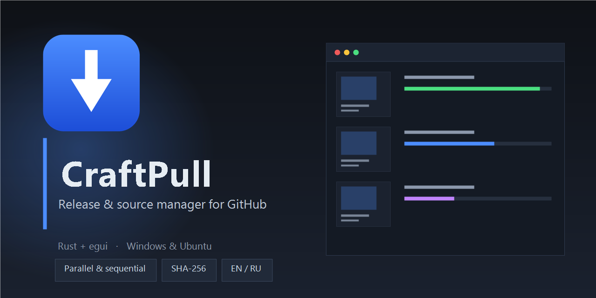
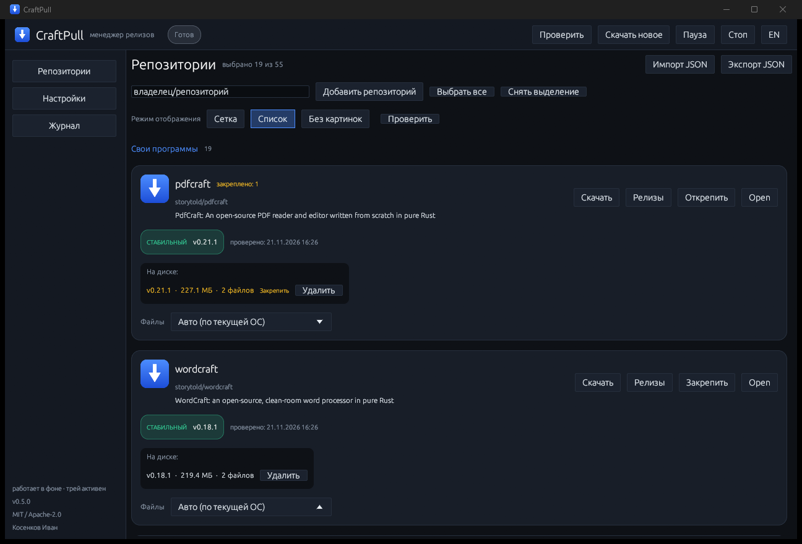
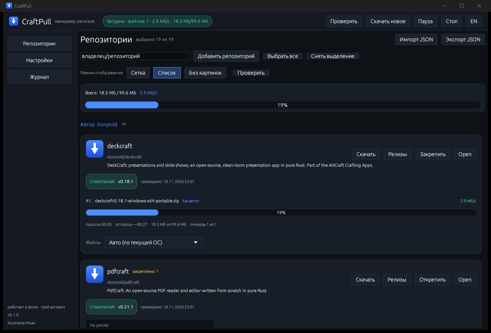
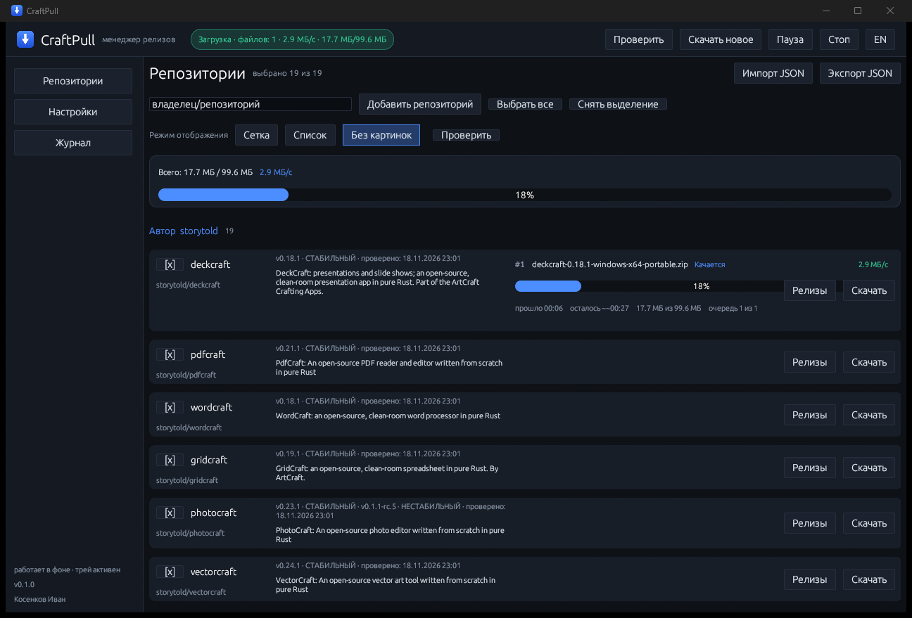
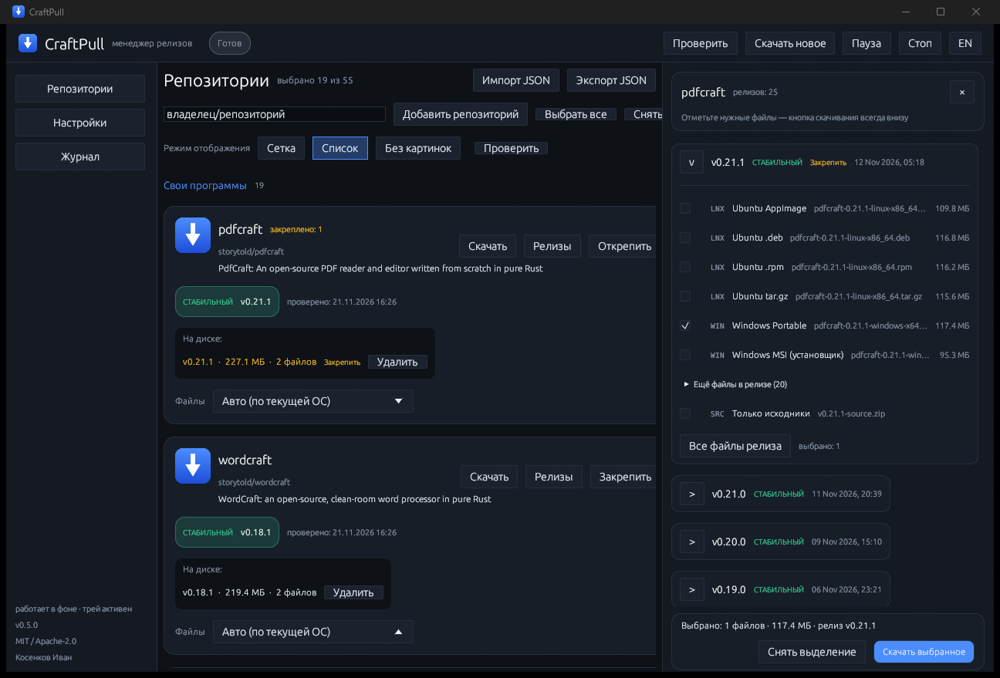
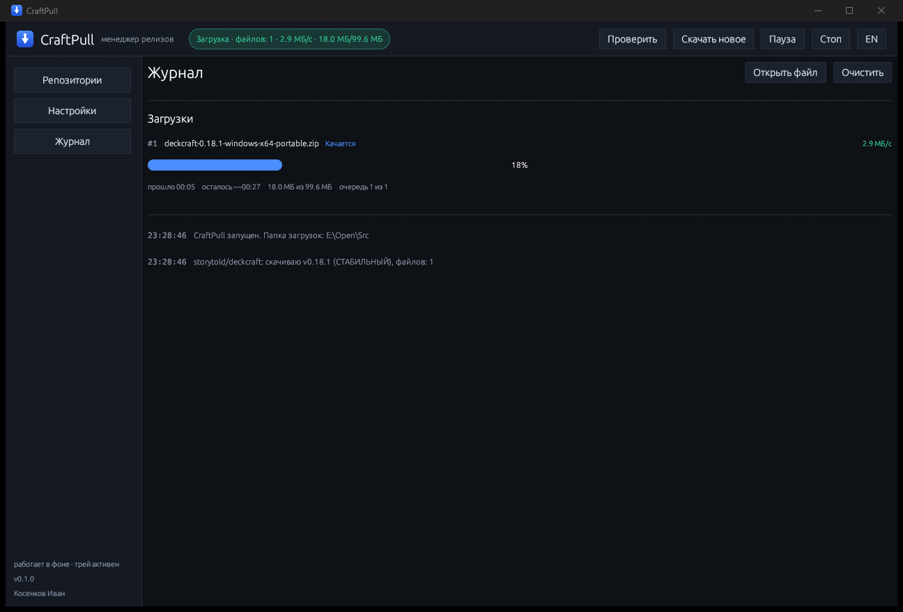
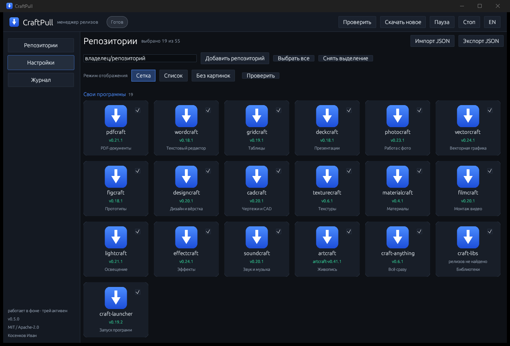
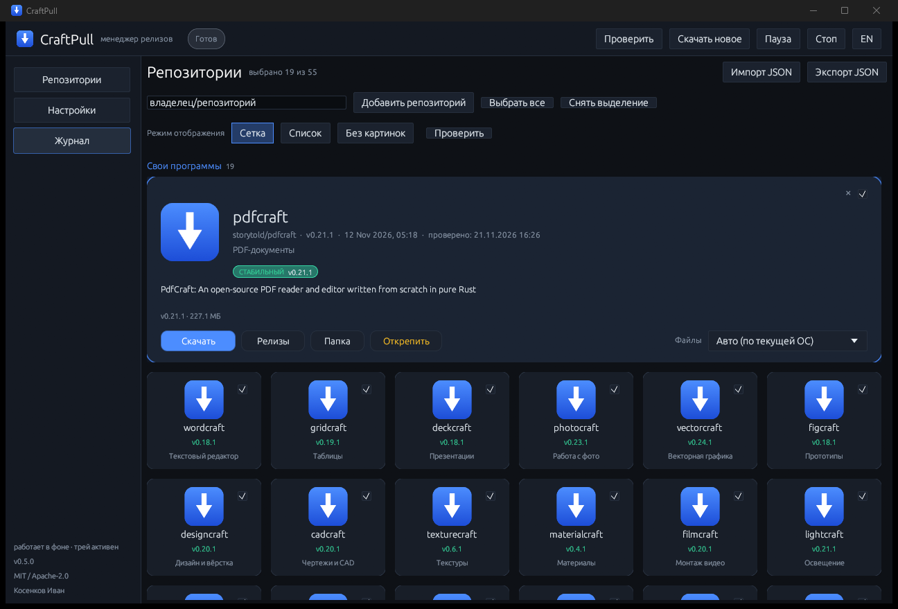
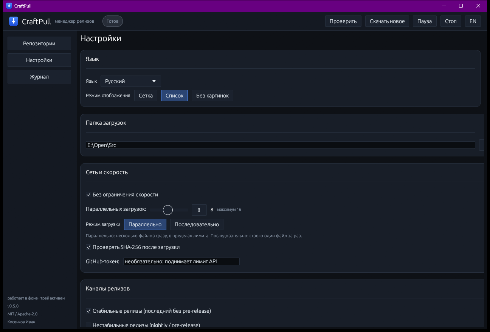
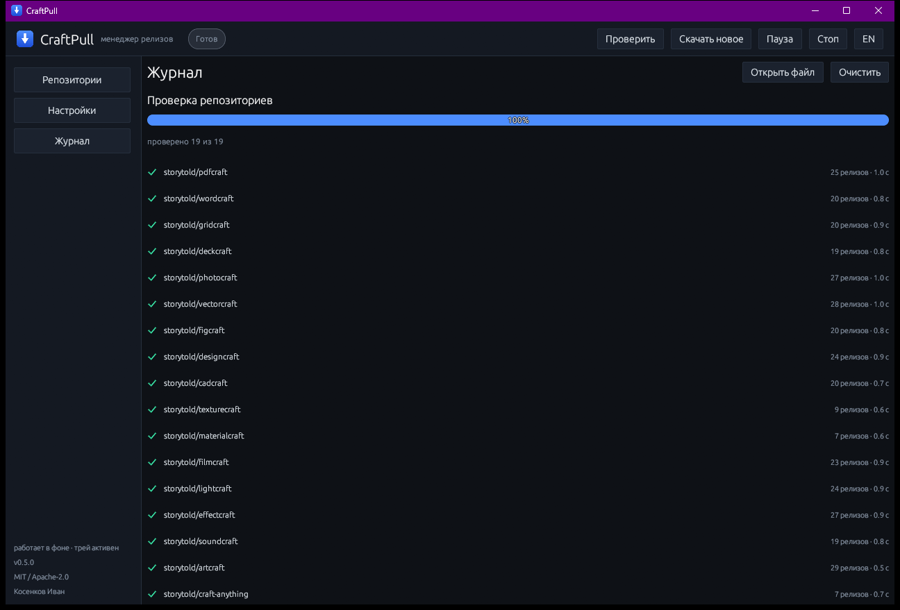

<div align="center">
  

  <h1>CraftPull</h1>

  <p><b>A release &amp; source manager for GitHub repositories</b><br>
  Native desktop GUI written in Rust — no Electron, no web engine.</p>

  <p>
    <a href="README.md"><b>🇬🇧 English</b></a>
    &nbsp;·&nbsp;
    <a href="README.ru.md"><b>🇷🇺 Русский</b></a>
  </p>

  <p>
    
    
    
    
  </p>
</div>

---

## What it does

CraftPull is a **desktop release manager for GitHub**. Point it at your repositories, and it
watches them for new releases, downloads the release assets (Windows `zip`, Ubuntu `tar.gz`,
`.AppImage`, `.msi`, `.deb` or source archives), verifies their SHA-256 checksums and removes the
outdated versions — leaving the ones you pinned alone.

It is a **native Rust application** built with **egui/eframe**: no Electron, no bundled browser,
no web engine. It runs in the system tray, and it keeps working even when the anonymous GitHub
API quota is exhausted.

**Keywords:** `github release manager`, `github downloader`, `release asset downloader`,
`auto update tool`, `rust desktop app`, `egui`, `windows`, `ubuntu`, `linux`,
`sha256`, `version manager`.

## Screenshots

**Repository list** — icons pulled from the repositories themselves, descriptions fetched from
GitHub, and the latest stable/edge versions per channel. The file filter picks the build for
the **current operating system** on its own.



**Detailed progress** — every running download shows its queue number, the file name, the
current speed, the percentage in the middle of the bar, the time passed, the estimated time
left, the transferred volume and the place in the queue.



**Light view** — the same detailed progress block, but without the icons: name, metadata,
description and progress in three columns.



**Releases panel** — the releases open **inside the page**, on the right side. Every file of
a release is ticked by hand, and the **Download selected** button stays visible at the bottom
with the total size of the selection.



**Download legend** — the log tab opens with the list of the running downloads: number, name,
speed, percentage, time passed, time left and volume.



**Grid view** — all repositories of an author in one screen, icons cached locally. A tile that
is downloading shows only the bar and the percentage.



**Hero card** — click a card and it unfolds across the whole row. The icon and the name morph
into their new places, the neighbouring tiles slide down, and the **Download** button, the
description, the file filter and the pin appear right there — no second window, no dialog.



**Settings** — download folder, speed limit, download mode, channels, behaviour and program update.



**Log** — every check, download and cleanup is recorded in English or Russian, on screen and on disk.
The **Check** button shows a live list of what is being checked at the moment.



---

## Key features

> ### ⭐ Hero card, animated with a real spring
> Click any card in the grid and it **unfolds** across the whole row. The icon grows from
> 56 to 84 px and the name grows with it, the neighbouring tiles slide down, and the
> **Download** button, the description, the file filter and the pin fade in.
> The motion is driven by an actual spring (`k = 165`, `ζ = 0.55`): it overshoots a little
> and settles — the kind of transition a designer puts in a showcase, not a CSS easing curve.
> Click the header, the **×** or press **Esc** to fold it back.

> ### ⭐ Automatic release tracking
> CraftPull watches your repositories and fetches every new release on its own.
> Each repository has **two channels**:
> * **STABLE** — the newest release without a pre-release flag;
> * **UNSTABLE** — the newest pre-release / nightly / rc build.
>
> If a repository has **only one** release, exactly **one** new version is downloaded.
> If both channels exist, **both** are downloaded — and only *after* they succeed are the
> older versions removed.

> ### ⭐ Self-cleaning storage
> Older versions are deleted automatically once the new ones are on disk.
> A release you **pin** (📌) is never deleted — not even manually — and the program warns you
> before you try.
> If a download fails, **nothing is removed**: a broken connection can never cost you the
> version you already have.

> ### ⭐ Speed limit, pause, resume and stop
> A global speed limit in MB/s (measured: **3.9 MB/s** under a 4 MB/s cap).
> **Pause** keeps the partial file and continues later via HTTP `Range`;
> **Stop** aborts everything instantly — the network read and the rate limiter are both
> interrupted at once, so nothing keeps running in the background.

> ### ⭐ Parallel or sequential downloads
> CraftPull downloads **in parallel** by default: several files at the same time, within the
> configured limit, and several repositories at the same time as well.
> Switch the mode in the settings to **sequential** — then exactly one file is downloaded at a
> time and the repositories are processed one after another. Useful on a thin channel or when
> you want to see every release come in on its own.

> ### ⭐ Detailed progress, everywhere
> Every running download is described in full: its **number in the queue**, the **file name**,
> the **current speed**, the **percentage in the middle of the bar**, the **time passed**, the
> **estimated time left**, the **volume** and the **place in the queue**.
> The same block is used in the **log legend**, in the **list** cards and in the **light** view —
> and the tiles of the **grid** keep it short: only the bar and the percentage.

> ### ⭐ The right file for your system
> The file filter is filled with the **real files of the release**, not with guesses.
> By default it selects the build for the **current operating system** — *Windows Portable*,
> *Windows MSI*, *Ubuntu AppImage*, *Ubuntu .deb*, *Ubuntu tar.gz* — and falls back to the
> source archive if the release has no binary for your system.

> ### ⭐ Releases inside the page
> The releases open in a **panel on the right side of the page**, not in a separate window.
> Every release can be unfolded, every file can be ticked by hand, and the
> **Download selected** button always stays at the bottom with the total size of the selection.

> ### ⭐ See what is being checked
> The **Check** button does not just refresh in the background — it shows **what is being
> checked right now**: a progress bar, "checked N of M", and a line per repository with its
> channel, its version and the number of releases found.

> ### ⭐ Live download list
> The **Log** tab opens with a live list of the running downloads: a progress bar per file,
> the percentage, the current speed, the remaining time and the state of every task.
> The status chip in the header shows the overall picture — number of active files, total
> speed and how much of the volume is already on disk.

> ### ⭐ Two languages, one click
> The interface speaks **English** and **Russian**. The **EN / RU** button in the top right
> corner switches the language instantly, without a restart; the same choice is available in
> the settings.

> ### ⭐ Works in the background
> Closing the window hides the program in the **system tray**. The tray menu offers
> *Show window / Pause / Stop downloads / Exit*, and the icon changes colour with the state.

> ### ⭐ Any file of any release
> By default only the build for the **current operating system** is fetched — Windows x64
> (zip) and Ubuntu x86_64 (AppImage) — with a graceful fallback to `.msi` / `.deb` / source
> archives.
> But the releases panel lets you tick **any** file of a release, or take **every** file.

> ### ⭐ Works even when the GitHub API is rate-limited
> Anonymous GitHub API access is limited to **60 requests per hour per IP** — behind a shared
> office or mobile address that runs out in minutes. When the API refuses, CraftPull silently
> falls back to the public release pages and keeps working, including SHA-256 checksums.

> ### ⭐ Organised by author
> Repositories are grouped by owner, your own repositories can be added at any time,
> descriptions and icons are stored locally, and the whole list travels as **JSON**
> (import/export, pins included).

> ### ⭐ Updates itself with one button
> The settings have a **Program update** section: a **Check for updates** button and — when a
> new version is out — a highlighted **Update to v0.5.0**. CraftPull downloads the release
> file straight from GitHub, checks its SHA-256 sum, unpacks the executable, replaces the
> current one with it and starts the program again. A check also runs at start-up.
>
> ### ⭐ Updates itself from source
> CraftPull pulls its own sources with `git`, builds them with `cargo` and replaces the running
> executable after it exits — no installer, no update server.

---

## Everything else

| | Feature |
|---|---|
| **Channels** | Stable and unstable tracks, switchable independently in the settings — the unstable track is **off by default** |
| **Verification** | SHA-256 of every downloaded file, checked against the digest published by GitHub |
| **Resume** | Interrupted downloads continue from the byte they stopped at (`HTTP Range`) |
| **Parallelism** | Whole numbers only: from 1 to **16** simultaneous downloads (8 by default) — or switch to a strictly sequential mode |
| **File filter** | The real files of the release, with the build for the current OS picked automatically |
| **Views** | **Grid** (default) with a spring-animated hero card, **List** and **Light** (no icons) — both with a detailed progress block |
| **Icons** | Repository icons are downloaded once and cached on disk; a repository without one gets the CraftPull icon |
| **Import / Export** | The repository list, with descriptions, pins and purposes, as JSON |
| **Purpose** | Every program has a short purpose («PDF-документы», «Монтаж видео», «Скриншоты») — shown in the grid tile and kept in the JSON |
| **Catalog** | A ready-made catalog of **55 programs**, grouped by category: screenshots and recording, video and audio, graphics and 3D, system and network, security and offline, self-hosted servers. Programs without binary releases on GitHub are downloaded as source archives |
| **License** | The program's own license — `MIT / Apache-2.0` — in the sidebar, with an explanation on hover |
| **Languages** | English (default) and Russian — the **EN / RU** button in the header switches instantly |
| **Autostart** | Optional start with Windows, hidden in the tray |
| **Portable builds** | Windows `zip`, macOS `.app` (universal) and Ubuntu `tar.gz` with `.desktop` and `install.sh` |

---

## Author & contacts

**Kosenkov Ivan** — the author of CraftPull.

| | |
|---|---|
| ✉️ Email | [support@chekak.store](mailto:support@chekak.store) |
| 🌐 Website | [chekak.store](https://chekak.store) |
| ✈️ Telegram | [t.me/chekakstore](https://t.me/chekakstore) |

Questions, bug reports and feature requests — write to the address above, the same details are
shown in the **About** section of the settings.

---

## Requirements

* **To run a ready build:** Windows 10/11, macOS 11+ or Ubuntu 22.04+
* **To build from source:** Rust 1.82 or newer
* **For self-update:** `cargo` must be available in `PATH`

---

## Downloads

Ready-made packages are published on the **[Releases page](https://github.com/KosenkovPro/craftpuller/releases)**:

| Platform | Package |
|---|---|
| Windows x64 | `craftpull-*-windows-x64.zip` — portable, no installer needed |
| macOS (Intel + Apple Silicon) | `craftpull-*-macos-universal.zip` — `CraftPull.app`, runs on both architectures |
| Ubuntu / Debian x86_64 | `craftpull-*-linux-x86_64.deb` — `sudo apt install ./craftpull-*.deb` |
| Linux x86_64 | `craftpull-*-linux-x86_64.tar.gz` — with `install.sh` and a `.desktop` entry |

Unpack the Windows archive and run `craftpull.exe`. The macOS archive contains `CraftPull.app` —
unpack it and drag the app into «Applications», or run it straight from the folder. The `.deb`
package puts the binary into `/usr/bin`, the icon into `/usr/share/icons` and the desktop entry
into `/usr/share/applications`. The Linux archive contains `install.sh`, which puts the binary into
`~/.local/bin` and registers the desktop entry and the icon.

---

## Building

```sh
git clone https://github.com/KosenkovPro/craftpuller.git
cd craftpuller
cargo build --release
```

The binary lands in `target/release/craftpull`.

### Portable packages

```powershell
# Windows: a zip with the executable and the icon
.\packaging\build-portable.ps1
```

```sh
# Ubuntu / Linux: a tar.gz with the binary, icon, .desktop file and install.sh
./packaging/build-portable.sh

# Ubuntu / Debian: a .deb package (binary -> /usr/bin, icon and .desktop entry)
./packaging/build-deb.sh
```

```sh
# macOS: a universal .app (Intel + Apple Silicon) and a zip with it
./packaging/build-macos.sh
```

CI builds all the packages automatically: `.github/workflows/portable.yml`
(triggered by a `v*` tag or manually). The Ubuntu package ships `install.sh`, which puts the
binary into `~/.local/bin` and registers the `.desktop` entry and the icon; the `.deb` package
installs the same files system-wide; the macOS package is a ready-to-move `CraftPull.app`.

### Desktop shortcut (Windows)

```powershell
.\target\release\craftpull.exe --install-shortcut
```

The program is copied to `%LOCALAPPDATA%\Programs\CraftPull`, the icon is drawn procedurally,
and a `CraftPull.lnk` shortcut appears on the desktop. The **Create a desktop shortcut** button
in the settings does exactly the same.

---

## Usage

1. Launch the program — **no repository is selected by default**.
2. Tick the ones you need (left column, or *Select all*), and add your own repositories as
   `owner/repository`.
3. **Check** — CraftPull queries GitHub and shows the latest release of each channel. While it
   works, the **log** shows what exactly is being checked right now: a progress bar, "checked N
   of M" and a line per repository.
4. **Click a card** in the grid — it unfolds into a hero card: description, **Download**,
   file filter and pin, all in one place.
5. **Download new** — the new versions are fetched; afterwards the old ones are removed,
   except the pinned ones.
6. **Releases** opens the panel on the right side of the page: download a specific tag, tick
   individual files by hand, or take every file of the release — the **Download selected**
   button stays at the bottom of the panel at all times.

The **CraftPull icon** on the left of the header is the way back to the main menu from any tab,
and the **EN / RU** button on the right switches the language of the interface instantly.

### Command line

| Command | Action |
|---|---|
| `craftpull` | open the window |
| `craftpull --tray` | start minimised in the tray |
| `craftpull --install-shortcut` | create a desktop shortcut |
| `craftpull --export-icon <file.png>` | save the 256×256 icon as PNG |
| `craftpull --selftest [owner/repo]` | end-to-end check: query GitHub and download a release, no window |
| `craftpull --tab <repos\|settings\|logs>` | open a specific tab |
| `craftpull --view <grid\|list\|light>` | open a specific view mode |
| `craftpull --popup <owner/repo>` | open the releases panel of a repository |
| `craftpull --hero <owner/repo>` | open the grid with the card of that repository already unfolded |
| `craftpull --download <owner/repo>` | start the download of that repository right away |
| `craftpull --no-icons` | do not download or show the icons of third-party applications |
| `craftpull --no-refresh` | do not contact GitHub on start, use the cache |
| `craftpull --refresh` | refresh the repositories even if the cache is fresh |
| `craftpull --version` | show the version |

---

## Files on disk

| What | Where |
|---|---|
| Settings | `%APPDATA%\CraftPull\config.json` |
| Log file | `%LOCALAPPDATA%\CraftPull\craftpull.log` |
| Release cache | `%LOCALAPPDATA%\CraftPull\releases-cache.json` |
| Icon cache | `%LOCALAPPDATA%\CraftPull\icons\` |
| Sources for self-update | `%LOCALAPPDATA%\CraftPull\self-source\` |
| Downloaded releases | the folder from the settings, `E:\Open\Src` by default |

Downloads are laid out as `<root>\<repository>\<tag>\<files>`, with a `meta.json` next to them
holding the tag, the channel and the install time.

The release cache survives restarts and keeps the program usable when the network or the API
quota lets you down: fresh data is shown instantly and refreshed in the background.

---

## Repository list JSON format

```json
{
  "version": 1,
  "exported_at": "2026-11-17T22:00:00+03:00",
  "repos": [
    {
      "slug": "storytold/pdfcraft",
      "enabled": true,
      "description": "An open-source PDF reader and editor written from scratch in pure Rust",
      "purpose": "PDF-документы",
      "category": "own",
      "pinned": ["v0.21.1"],
      "filter": "Auto",
      "clone_source": false
    }
  ]
}
```

`filter`: `Auto` (the build for the current operating system — the default), `WindowsPortable`,
`WindowsMsi`, `WindowsSetup`, `LinuxAppImage`, `LinuxTarGz`, `LinuxDeb`, `LinuxRpm`,
`Source` (source archive only), `All` (every file of the release).
The old value `Portable` is still accepted and behaves like `Auto`.

`purpose`: a short line about what the program is for («PDF-документы», «Монтаж видео»,
«Скриншоты»). It is shown in the grid tile under the name and travels with the repository
through export and import. The field is optional — an empty value simply means "no purpose".

`category`: the key of the group the program is shown in (`own`, `capture`, `media`,
`graphics`, `system`, `security`, `server`). The group names are translated by the interface,
so only the key is stored. The field is optional too.

---

## Program update

The settings have a **Program update** section: it shows the installed version, a
**Check for updates** button and — when a new version is out — a highlighted
**Update to v0.5.0** button. CraftPull downloads the release file straight from GitHub,
checks its SHA-256 sum against the one GitHub reports, unpacks the executable, replaces the
current one with it and starts the program again. A check for a new version also runs at
start-up — the program itself reports that an update is available.

The release source is the official repository by default; it can be changed with the
`self_update_repo` field of the settings.

### Update from sources

The old way is still there as a fallback: point the settings at the repository with the
sources (`owner/repo`) or at a local folder with
them and press **Update the program now**. CraftPull runs `git pull`, builds the project
(`cargo build --release`), stores the new binary next to the current one and swaps it in on the
next start.

---

## How it is built

| Module | Purpose |
|---|---|
| `src/main.rs` | entry point, CLI arguments, window start-up |
| `src/lang.rs` | English and Russian interface |
| `src/config.rs` | settings, repository list, JSON exchange format |
| `src/cache.rs` | release cache on disk — survives restarts, saves API quota |
| `src/github.rs` | GitHub REST API: releases, repository descriptions |
| `src/webfeed.rs` | fallback: public GitHub pages when the API limit is hit |
| `src/icons.rs` | repository icon download and local cache |
| `src/download.rs` | downloader: speed limit, pause, resume, SHA-256 |
| `src/manager.rs` | download planning, cleanup of old versions, pins, file selection |
| `src/model.rs` | common data model: tasks, progress, releases, formatting |
| `src/storage.rs` | version folders on disk, scanning, cleanup |
| `src/selfupdate.rs` | self-update from sources, Windows autostart |
| `src/updater.rs` | update from the GitHub release binaries: check, SHA-256, file replacement |
| `src/tray.rs` | system tray icon and menu |
| `src/icon.rs` | procedural icon, ICO/PNG, shortcut creation |
| `src/ui/hero.rs` | hero card: custom layout, shared-element morph, card actions |
| `src/ui/anim.rs` | spring physics behind every animation |
| `src/ui/progress.rs` | progress bar with the percentage in the middle, detailed progress block |
| `src/ui/releases.rs` | releases panel inside the page, file selection, "Download selected" |
| `src/ui/logs.rs` | list of checks and live list of downloads |
| `src/ui/` | egui interface: repositories, settings, log |

The UI is built with **egui/eframe**, networking with **reqwest + tokio**, the tray icon with
**tray-icon + muda**, and everything is bundled into a single executable with no runtime
dependencies.

---

## License

MIT **or** Apache-2.0 — your choice. See [LICENSE](LICENSE).

---

<p align="center">
  <a href="README.md"><b>🇬🇧 English</b></a>
  &nbsp;·&nbsp;
  <a href="README.ru.md"><b>🇷🇺 Русский</b></a>
</p>
