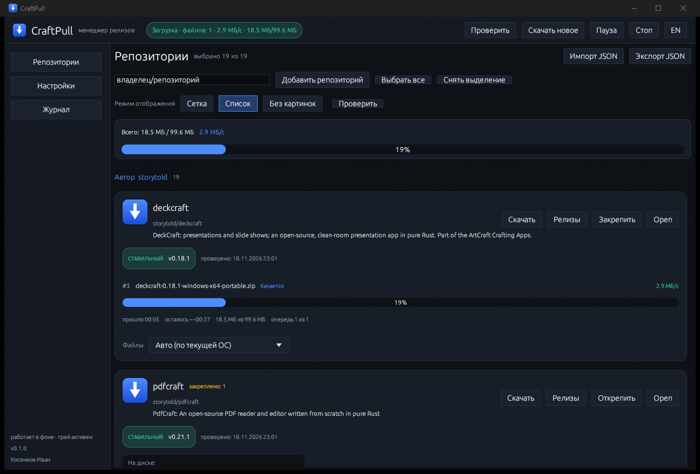
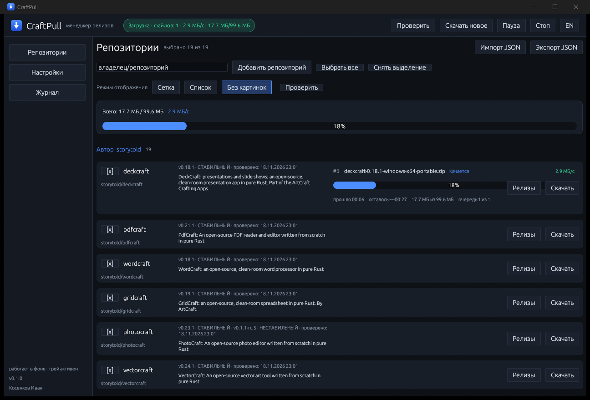
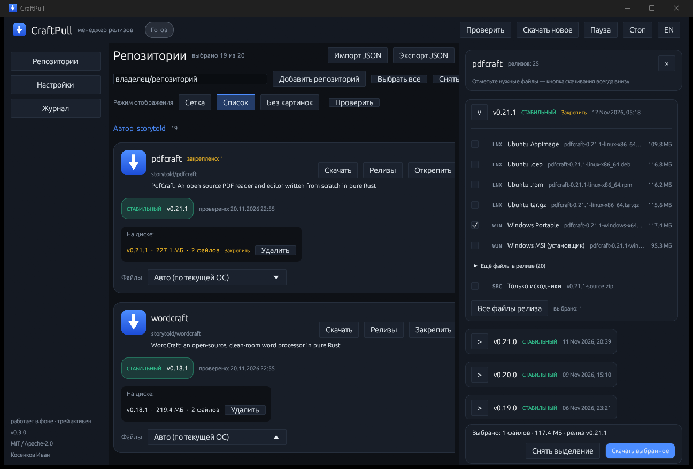
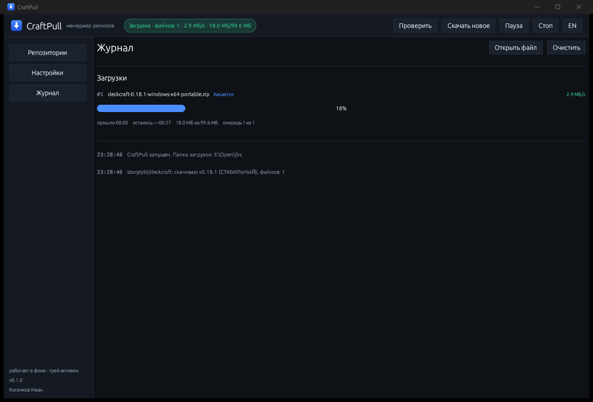
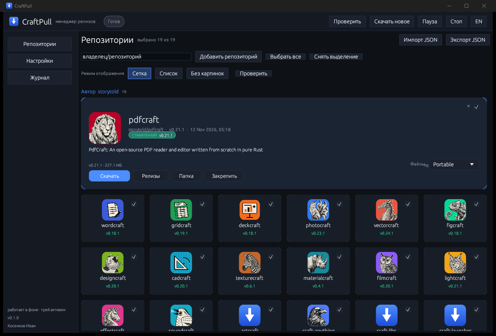
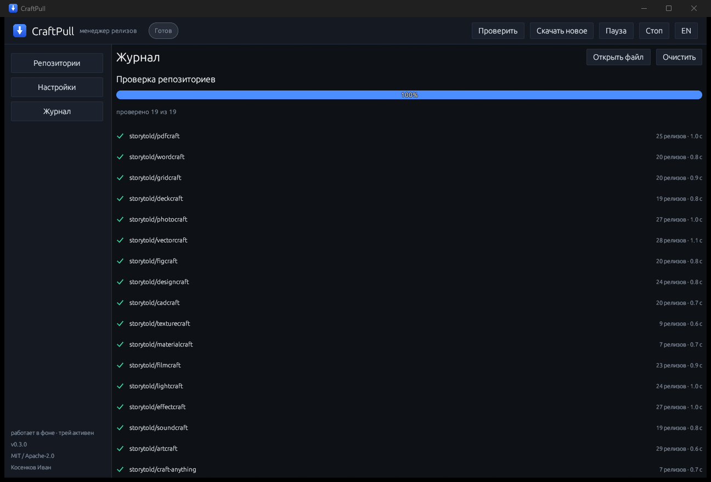

<div align="center">
  

  <h1>CraftPull</h1>

  <p><b>Менеджер релизов и исходников для репозиториев GitHub</b><br>
  Нативное графическое приложение на Rust — без Electron и без веб-движка.</p>

  <p>
    <a href="README.md"><b>🇬🇧 English</b></a>
    &nbsp;·&nbsp;
    <a href="README.ru.md"><b>🇷🇺 Русский</b></a>
  </p>

  <p>
    
    
    
    
  </p>
</div>

---

## Что это делает

CraftPull — **менеджер релизов для GitHub**. Укажите свои репозитории — программа сама
следит за новыми релизами, скачивает файлы релиза (Windows `zip`, Ubuntu `tar.gz`, `.AppImage`,
`.msi`, `.deb` или архивы исходников), сверяет их контрольные суммы SHA-256 и удаляет
устаревшие версии, а закреплённые оставляет нетронутыми.

Это **нативное приложение на Rust** на **egui/eframe**: без Electron, без встроенного браузера,
без веб-движка. Оно живёт в системном трее и продолжает работать даже тогда, когда
анонимный лимит GitHub API исчерпан.

**Ключевые слова:** `менеджер релизов github`, `скачивание релизов github`,
`автообновление программ`, `приложение на rust`, `egui`, `windows`, `ubuntu`, `linux`,
`sha256`, `контрольные суммы`.

## Скриншоты

**Список репозиториев** — иконки подтягиваются из самих репозиториев, описания берутся с
GitHub, для каждого показан последний стабильный и нестабильный релиз. Выбор файла сам
подбирает сборку под **текущую операционную систему**.


**Подробный прогресс** — у каждой загрузки видно её номер в очереди, имя файла, текущую
скорость, процент по центру полосы, прошедшее время, оставшееся время, объём и место в очереди.



**Без картинок** — тот же подробный блок прогресса, но без иконок: название, метаданные,
описание и прогресс в трёх колонках.



**Панель релизов** — релизы открываются **внутри страницы**, справа. Файлы релиза
отмечаются галочками, а кнопка **«Скачать выбранное»** всегда висит внизу и показывает
итоговый размер выбранного.



**Легенда загрузок** — вкладка «Журнал» открывается списком текущих загрузок: номер, имя
файла, скорость, процент, прошедшее и оставшееся время, объём.



**Сетка** — все репозитории автора на одном экране, иконки лежат в локальном кэше.
У скачиваемой плитки остаётся только полоса и процент.


**Карточка-герой** — клик по карточке, и она разворачивается на всю ширину ряда. Иконка и
название переезжают на новые места, соседние плитки уезжают вниз, а прямо здесь появляются
кнопка **«Скачать»**, описание, выбор файлов и закреп — без второго окна и без диалогов.



**Настройки** — папка загрузок, ограничение скорости, режим загрузки, каналы, поведение и
обновление программы.


**Журнал** — каждая проверка, загрузка и уборка записывается на английском или русском:
на экране и в файл. Кнопка **«Проверить»** показывает, что именно проверяется прямо сейчас.



---

## Ключевые возможности

> ### ⭐ Карточка-герой с настоящей пружинной анимацией
> Кликните по любой карточке в сетке — она **разворачивается** на всю ширину ряда.
> Иконка вырастает с 56 до 84 px, вместе с ней растёт название, соседние плитки уезжают
> вниз, а проявляются кнопка **«Скачать»**, описание, выбор файлов и закреп.
> Движением управляет настоящая пружина (`k = 165`, `ζ = 0.55`): она слегка перелетает
> и успокаивается — как переходы в шоу-дизайне, а не как CSS-кривая.
> Заголовок, крестик **×** или **Esc** сворачивают карточку обратно.

> ### ⭐ Следит за репозиториями и сам качает новые релизы
> У каждого репозитория **два канала**:
> * **СТАБИЛЬНЫЙ** — последний релиз без pre-release;
> * **НЕСТАБИЛЬНЫЙ** — последний pre-release / nightly / rc.
>
> Если доступен **только один** релиз — скачивается ровно **одна** новая версия.
> Если доступны оба канала — скачиваются **оба**, и только *после* этого
> удаляются старые версии.

> ### ⭐ Убирает старые версии сам
> Старые версии удаляются автоматически, как только новые оказались на диске.
> Релиз, который вы **закрепили** (📌), не удаляется никогда — даже вручную, —
> а программа предупредит, если вы попробуете.
> Если загрузка не удалась, **не удаляется ничего**: обрыв связи не может стоить вам
> уже скачанной версии.

> ### ⭐ Ограничение скорости, пауза, докачка и стоп
> Общий лимит скорости в МБ/с (замерено: **3.9 МБ/с** при потолке 4 МБ/с).
> **Пауза** сохраняет недокачанный файл и продолжает его позже через HTTP `Range`;
> **Стоп** мгновенно прерывает всё: обрывается и чтение из сети, и ожидание паузы
> в ограничителе скорости — в фоне ничего не продолжает качаться.

> ### ⭐ Параллельные или последовательные загрузки
> По умолчанию CraftPull качает **параллельно**: несколько файлов одновременно в пределах
> заданного лимита и несколько репозиториев одновременно.
> В настройках режим переключается на **последовательный** — тогда одновременно качается
> ровно один файл, а репозитории обрабатываются по очереди. Удобно на узком канале или
> когда хочется видеть каждый релиз отдельно.

> ### ⭐ Подробный прогресс везде
> Каждая загрузка описана целиком: её **номер в очереди**, **имя файла**, **текущая скорость**,
> **процент по центру полосы**, **прошедшее время**, **оставшееся время ориентировочно**,
> **объём** и **место в очереди**.
> Такой же блок работает в **легенде загрузок**, в карточках режима **«Список»** и в режиме
> **«Без картинок»** — а в плитках **сетки** остаётся коротко: только полоса и процент.

> ### ⭐ Нужный файл для вашей системы
> В выпадающем списке выбора файла стоят **реальные файлы релиза**, а не догадки.
> По умолчанию отмечается сборка под **текущую операционную систему** — *Windows Portable*,
> *Windows MSI*, *Ubuntu AppImage*, *Ubuntu .deb*, *Ubuntu tar.gz*, — а если бинарника под вашу
> систему нет, подставляется архив исходников.

> ### ⭐ Релизы внутри страницы
> Релизы открываются **панелью справа на странице**, а не отдельным окном.
> Любой релиз можно раскрыть, любой файл отметить галочкой, а кнопка
> **«Скачать выбранное»** всегда остаётся внизу панели вместе с итоговым размером выбранного.

> ### ⭐ Видно, что именно проверяется
> Кнопка **«Проверить»** не просто обновляет данные в фоне — она показывает, **что проверяется
> прямо сейчас**: полосу прогресса, «проверено N из M» и строку по каждому репозиторию с каналом,
> версией и числом найденных релизов.

> ### ⭐ Живой список загрузок
> Вкладка **«Журнал»** открывается списком текущих загрузок: у каждой — полоса прогресса,
> процент, текущая скорость, оставшееся время и состояние задачи.
> А чип статуса в шапке показывает общую картину: сколько файлов в работе, суммарная
> скорость и сколько мегабайт из скольких уже на диске.

> ### ⭐ Два языка в один клик
> Интерфейс говорит на **английском** и **русском**. Кнопка **EN / RU** в правом верхнем углу
> переключает язык мгновенно, без перезапуска; тот же выбор есть и в настройках.

> ### ⭐ Работает в фоне
> Закрытие окна прячет программу в **системный трей**. В меню трея есть
> *Показать окно / Пауза / Остановить загрузки / Выход*, а значок меняет цвет
> по состоянию.

> ### ⭐ Любой файл любого релиза
> По умолчанию скачивается только сборка под **текущую операционную систему** — Windows x64
> (zip) и Ubuntu x86_64 (AppImage), с запасным вариантом `.msi` / `.deb` / архив исходников.
> Но в панели релизов можно отметить **любой** файл релиза или забрать **все** файлы.

> ### ⭐ Работает даже при исчерпанном лимите GitHub API
> Анонимный доступ к GitHub API ограничен **60 запросами в час на IP-адрес** — за
> общим офисным или мобильным адресом он заканчивается за минуты. Когда API
> отказывает, CraftPull молча переключается на публичные страницы релизов и
> продолжает работать — вместе с проверкой SHA-256.

> ### ⭐ Всё разложено по авторам
> Репозитории сгруппированы по владельцу, свои репозитории добавляются в любой
> момент, описания и иконки хранятся локально, а весь список переносится в виде
> **JSON** (импорт/экспорт вместе с закрепами).

> ### ⭐ Обновляется сам по одной кнопке
> В настройках есть раздел **«Обновление программы»**: кнопка **«Проверить обновления»**
> и, если вышла новая версия, акцентная **«Обновить до v0.5.3»**. CraftPull скачивает
> релизный файл прямо с GitHub, сверяет контрольную сумму SHA-256, распаковывает
> исполняемый файл, подменяет им текущий и запускает программу заново.
> Проверка новой версии идёт и при запуске.

> ### ⭐ Обновляет сам себя из исходников
> CraftPull тянет собственные исходники через `git`, собирает их через `cargo`
> и подменяет запущенный файл после выхода — без установщика и без сервера
> обновлений.

---

## Всё остальное

| | Возможность |
|---|---|
| **Каналы** | Стабильный и нестабильный треки, включаются независимо в настройках — нестабильный **по умолчанию выключен** |
| **Проверка** | SHA-256 каждого скачанного файла сверяется с digest от GitHub |
| **Докачка** | Прерванная загрузка продолжается с того же байта (`HTTP Range`) |
| **Параллельность** | Только целые числа: от 1 до **16** одновременных загрузок (по умолчанию 8) — либо строго последовательный режим |
| **Выбор файла** | Реальные файлы релиза, сборка под текущую ОС подставляется сама |
| **Виды** | **Сетка** (по умолчанию) с пружинной карточкой-героем, **Список** и **Без картинок** — в последних двух подробный блок прогресса |
| **Иконки** | Иконки репозиториев скачиваются один раз и кэшируются на диске; если иконки нет — ставится иконка CraftPull |
| **Импорт / Экспорт** | Список репозиториев с описаниями, закрепами и назначениями в JSON |
| **Назначение** | У каждой программы есть короткое назначение («PDF-документы», «Монтаж видео», «Скриншоты») — оно видно в плитке и хранится в JSON |
| **Каталог** | Готовый каталог из **55 программ**, разбит по категориям: скриншоты и запись экрана, видео и аудио, графика и 3D, система и сеть, безопасность и оффлайн, self-hosted серверы. Программы без бинарных релизов на GitHub скачиваются как архивы с исходниками |
| **Лицензия** | Лицензия самой программы — `MIT / Apache-2.0` — в боковой панели, с пояснением при наведении |
| **Языки** | Английский (по умолчанию) и русский — кнопка **EN / RU** в шапке переключает мгновенно |
| **Автозапуск** | Необязательный запуск вместе с Windows, сразу в трее |
| **Portable-сборки** | Windows `zip`, macOS `.app` (universal) и Ubuntu `tar.gz` с `.desktop` и `install.sh` |

---

## Автор и контакты

**Косенков Иван** — автор CraftPull.

| | |
|---|---|
| ✉️ Почта | [support@chekak.store](mailto:support@chekak.store) |
| 🌐 Сайт | [chekak.store](https://chekak.store) |
| ✈️ Telegram | [t.me/chekakstore](https://t.me/chekakstore) |

Вопросы, баги и пожелания — на этот адрес; те же данные собраны в разделе
**«Об авторе»** в настройках.

---

## Требования

* **Для готовой сборки:** Windows 10/11, macOS 11+ или Ubuntu 22.04+
* **Для сборки из исходников:** Rust 1.82 или новее
* **Для самообновления:** в `PATH` должен быть `cargo`

---

## Загрузка

Готовые сборки публикуются на странице **[Releases](https://github.com/KosenkovPro/craftpuller/releases)**:

| Платформа | Пакет |
|---|---|
| Windows x64 | `craftpull-*-windows-x64.zip` — portable, установщик не нужен |
| macOS (Intel + Apple Silicon) | `craftpull-*-macos-universal.zip` — `CraftPull.app`, работает на обеих архитектурах |
| macOS только Intel | `craftpull-*-macos-x64.zip` — `CraftPull.app` для Intel |
| macOS только Apple Silicon | `craftpull-*-macos-arm64.zip` — `CraftPull.app` для Apple Silicon |
| macOS, образ диска | `craftpull-*-macos-universal.dmg` — перетащите приложение в «Программы» |
| macOS, установщик | `craftpull-*-macos-universal.pkg` — пошаговая установка в `/Applications` |
| Ubuntu / Debian x86_64 | `craftpull-*-linux-x86_64.deb` — `sudo apt install ./craftpull-*.deb` |
| Linux x86_64 | `craftpull-*-linux-x86_64.tar.gz` — с `install.sh` и `.desktop`-записью |

Распакуйте архив для Windows и запустите `craftpull.exe`. Архив для macOS содержит
`CraftPull.app` — распакуйте и перетащите приложение в «Программы», либо запустите прямо из
папки. Образ `.dmg` показывает обычное окно с приложением и ярлыком на папку Applications.
Установщик `.pkg` — обычный пошаговый установщик: программа кладётся в `/Applications`.
Пакет `.deb` кладёт бинарник в `/usr/bin`, иконку — в `/usr/share/icons`, а
`.desktop`-запись — в `/usr/share/applications`. Архив для Linux содержит `install.sh`, который
кладёт бинарник в `~/.local/bin` и регистрирует запись в меню приложений и иконку.

Сборки для macOS не подписаны: система покажет предупреждение «не проверено». Открыть
программу можно через правую кнопку → «Открыть», после чего macOS запомнит выбор.

---

## Сборка

```sh
git clone https://github.com/KosenkovPro/craftpuller.git
cd craftpuller
cargo build --release
```

Готовый бинарник появляется в `target/release/craftpull`.

### Portable-пакеты

```powershell
# Windows: zip с исполняемым файлом и иконкой
.\packaging\build-portable.ps1
```

```sh
# Ubuntu / Linux: tar.gz с бинарником, иконкой, .desktop-файлом и install.sh
./packaging/build-portable.sh

# Ubuntu / Debian: пакет .deb (бинарник -> /usr/bin, иконка и .desktop-запись)
./packaging/build-deb.sh
```

```sh
# macOS: universal .app (Intel + Apple Silicon) и zip с ним
./packaging/build-macos.sh
```

Все пакеты собирает CI: `.github/workflows/portable.yml`
(запуск по тегу `v*` или вручную). Ubuntu-пакет содержит `install.sh`, который кладёт
бинарник в `~/.local/bin` и регистрирует `.desktop`-запись и иконку; пакет `.deb`
ставит те же файлы на уровне системы; macOS-пакет — готовое приложение `CraftPull.app`.

### Ярлык на рабочем столе (Windows)

```powershell
.\target\release\craftpull.exe --install-shortcut
```

Программа копируется в `%LOCALAPPDATA%\Programs\CraftPull`, иконка рисуется процедурно,
на рабочем столе появляется ярлык `CraftPull.lnk`. То же самое делает кнопка
«Создать ярлык на рабочем столе» в настройках.

---

## Использование

1. Запустите программу — **по умолчанию не выбран ни один репозиторий**.
2. Отметьте нужные (колонка слева или «Выбрать все») и добавьте свои репозитории
   строкой `владелец/репозиторий`.
3. **«Проверить»** — программа опросит GitHub и покажет последние релизы по каналам.
   Пока идёт проверка, в **журнале** видно, что именно проверяется прямо сейчас: полоса,
   «проверено N из M» и строка по каждому репозиторию.
4. **Кликните по карточке** в сетке — она развернётся в карточку-герой: описание,
   кнопка **«Скачать»**, выбор файлов и закреп в одном месте.
5. **«Скачать новое»** — скачаются новые версии; после успеха старые версии будут удалены,
   кроме закреплённых.
6. **«Релизы»** открывают панель справа на странице: скачать конкретный тег, отметить
   отдельные файлы вручную или забрать все файлы релиза — кнопка **«Скачать выбранное»**
   всегда внизу панели.

**Иконка CraftPull** слева в шапке — возврат в главное меню из любой вкладки,
а кнопка **EN / RU** справа мгновенно переключает язык интерфейса.

### Команды

| Команда | Действие |
|---|---|
| `craftpull` | открыть окно |
| `craftpull --tray` | запустить свёрнутым в трей |
| `craftpull --install-shortcut` | создать ярлык на рабочем столе |
| `craftpull --export-icon <file.png>` | сохранить иконку 256×256 |
| `craftpull --selftest [owner/repo]` | сквозная проверка: опросить GitHub и скачать релиз, без окна |
| `craftpull --update` | проверить обновление программы и установить его, без окна |
| `craftpull --tab <repos\|settings\|logs>` | открыть нужную вкладку |
| `craftpull --view <grid\|list\|light>` | открыть нужный режим отображения |
| `craftpull --popup <owner/repo>` | открыть панель релизов репозитория |
| `craftpull --hero <owner/repo>` | открыть сетку с уже развёрнутой карточкой этого репозитория |
| `craftpull --download <owner/repo>` | сразу начать скачивание этого репозитория |
| `craftpull --no-icons` | не скачивать и не показывать иконки сторонних приложений |
| `craftpull --no-refresh` | не обращаться к GitHub при старте, взять данные из кэша |
| `craftpull --refresh` | обновить репозитории, даже если кэш свежий |
| `craftpull --version` | показать версию |

---

## Файлы на диске

| Что | Где |
|---|---|
| Настройки | `%APPDATA%\CraftPull\config.json` |
| Файл журнала | `%LOCALAPPDATA%\CraftPull\craftpull.log` |
| Кэш релизов | `%LOCALAPPDATA%\CraftPull\releases-cache.json` |
| Кэш иконок | `%LOCALAPPDATA%\CraftPull\icons\` |
| Исходники для самообновления | `%LOCALAPPDATA%\CraftPull\self-source\` |
| Скачанные релизы | папка из настроек, по умолчанию `E:\Open\Src` |

Раскладка скачанного: `<корень>\<репозиторий>\<тег>\<файлы>` — рядом лежит `meta.json`
с тегом, каналом и временем установки.

Кэш релизов переживает перезапуск и оставляет программу работоспособной, когда не
работает сеть или исчерпан лимит API: свежие данные показываются сразу, а обновляются
в фоне.

---

## Формат JSON списка репозиториев

```json
{
  "version": 1,
  "exported_at": "2026-11-17T22:00:00+03:00",
  "repos": [
    {
      "slug": "storytold/pdfcraft",
      "enabled": true,
      "description": "An open-source PDF reader and editor written from scratch in pure Rust",
      "purpose": "PDF-документы",
      "category": "own",
      "pinned": ["v0.21.1"],
      "filter": "Auto",
      "clone_source": false
    }
  ]
}
```

`filter`: `Auto` (сборка под текущую операционную систему — по умолчанию), `WindowsPortable`,
`WindowsMsi`, `WindowsSetup`, `LinuxAppImage`, `LinuxTarGz`, `LinuxDeb`, `LinuxRpm`,
`Source` (только архив с исходниками), `All` (все файлы релиза).
Старое значение `Portable` принимается и работает как `Auto`.

`purpose`: короткая строка о назначении программы («PDF-документы», «Монтаж видео»,
«Скриншоты»). Она показывается в плитке под названием и переезжает вместе с репозиторием
при экспорте и импорте. Поле необязательное — пустое значение означает просто «назначения нет».

`category`: ключ группы, в которой программа показана в списке (`own`, `capture`, `media`,
`graphics`, `system`, `security`, `server`). Названия групп переводятся интерфейсом, поэтому
в файле лежит только ключ. Поле тоже необязательное.

---

## Обновление программы

В настройках есть раздел **«Обновление программы»**: там показана установленная версия,
кнопка «Проверить обновления» и — если вышла новая версия — акцентная кнопка
«Обновить до v0.5.3». CraftPull скачивает релизный файл прямо с GitHub, сверяет его
контрольную сумму SHA-256 с той, что отдаёт GitHub, распаковывает исполняемый файл,
подменяет им текущий и запускает программу заново. Проверка новой версии идёт и при
запуске — сама программа сообщает, что обновление доступно.

Источник релизов по умолчанию — официальный репозиторий; его можно поменять в поле
`self_update_repo` настроек. Если GitHub не пускает по лимиту API, программа читает
публичную страницу релиза — там тоже есть контрольная сумма файла.

### Обновление из исходников

Старый способ остался запасным: укажите в настройках репозиторий с исходниками
(`owner/repo`) или путь к папке с ними и нажмите «Обновить программу сейчас».
CraftPull выполнит `git pull`, соберёт проект
(`cargo build --release`), сохранит новый бинарник рядом с текущим и подменит его при
следующем запуске.

---

## Как это устроено

| Модуль | Назначение |
|---|---|
| `src/main.rs` | точка входа, параметры командной строки, запуск окна |
| `src/lang.rs` | английский и русский интерфейс |
| `src/config.rs` | настройки, список репозиториев, формат обмена JSON |
| `src/cache.rs` | кэш релизов на диске — переживает перезапуск, бережёт лимит API |
| `src/github.rs` | REST API GitHub: релизы, описания репозиториев |
| `src/webfeed.rs` | запасной путь: публичные страницы GitHub, когда исчерпан лимит API |
| `src/icons.rs` | скачивание и локальный кэш иконок репозиториев |
| `src/download.rs` | загрузка: лимит скорости, пауза, докачка, SHA-256 |
| `src/manager.rs` | планирование загрузок, очистка старых версий, закрепления, выбор файла |
| `src/model.rs` | общая модель данных: задачи, прогресс, релизы, форматирование |
| `src/storage.rs` | каталоги версий на диске, сканирование, очистка |
| `src/selfupdate.rs` | обновление из исходников, автозапуск Windows |
| `src/updater.rs` | обновление по релизным бинарникам GitHub: проверка, SHA-256, замена файла |
| `src/tray.rs` | значок и меню системного трея |
| `src/icon.rs` | процедурная иконка, ICO/PNG, создание ярлыка |
| `src/ui/hero.rs` | карточка-герой: своя раскладка, морф общего элемента, действия |
| `src/ui/anim.rs` | пружинная физика для всех анимаций |
| `src/ui/progress.rs` | полоса с процентом по центру и подробный блок прогресса |
| `src/ui/releases.rs` | панель релизов внутри страницы, выбор файлов, «Скачать выбранное» |
| `src/ui/logs.rs` | список проверок и живой список загрузок |
| `src/ui/` | интерфейс на egui: репозитории, настройки, журнал |

Интерфейс построен на **egui/eframe**, сеть — на **reqwest + tokio**, значок трея — на
**tray-icon + muda**. Всё собирается в один исполняемый файл без внешних зависимостей.

---

## Лицензия

MIT **или** Apache-2.0 — на ваш выбор. Смотрите [LICENSE](LICENSE).

---

<p align="center">
  <a href="README.md"><b>🇬🇧 English</b></a>
  &nbsp;·&nbsp;
  <a href="README.ru.md"><b>🇷🇺 Русский</b></a>
</p>
